# ARCH-001 Platform overview

<!--
Audience: owner, collaborators, new agents
Sources:
  - _KNOWLEDGE/Architecture/ARCH-002-SourceControl.md
  - _KNOWLEDGE/Architecture/ARCH-003-Hosting.md
  - _KNOWLEDGE/Architecture/ARCH-004-SiteBuild.md
  - _KNOWLEDGE/Architecture/ARCH-005-ResumeSpa.md
  - _KNOWLEDGE/Documents/Operations/log.md (2026-10-14 entries: cutover, then the host move to GitHub)
  - build.sh, wrangler.toml, site/quartz.config.ts, resumeContent/package.json
Human id: platform-overview
Last synthesized: 2026-10-14
-->

> The landing page of the Architecture set. Plain-language digest; the code is authoritative. Ratings use the scale in `_META/Definitions/Architecture.md`.

## The system in one paragraph

This repo publishes one website, **alonzo-anthologies.pages.dev**: a set of essays and an illustrated series written in Markdown, plus an interactive resume app, branded Alonzo's Anthologies, at `/resume/`. Everything lives in one public GitHub repo, `DeveloperZo/alonzo-anthologies`. Pushing to its `main` branch is the whole release process: GitHub tells Cloudflare Pages, Cloudflare runs one build script that turns the Markdown into pages with Quartz and builds the React resume app alongside, and publishes the result. Every other branch gets its own public preview address. Project notes like this page live in `_KNOWLEDGE/` and are never published. There is no CI, no database and no server code. **Deployed and verified on 2026-10-14:** production deploy `c7455b17` serves commit c6dadfe, built from GitHub after the Pages project was recreated with GitHub as its source that night. GitHub has been the only active code host since then; the GitLab project used for a few hours that day is archived. An older Pages project, `zo-garden`, is connected to the same repo and serves an identical copy of the site at `zo-garden.pages.dev` until it is retired.

## The whole system on one page

Read it left to right, following the numbered steps. The four boxes along the top are the four areas this set covers; the italic line under each names the page that explains it. The dashed row at the bottom is what is left over: the archived GitLab project, read-only, and the `zo-garden` project that the same push still builds, scheduled for retirement.

## The pages

| Page | What it covers | Read it when you want to know |
| --- | --- | --- |
| [ARCH-002 Source control](./ARCH-002-SourceControl.md) | GitHub, `main`, branch protection (none yet), the archived GitLab project, where secrets may and may not live | where the code lives and what a push really does |
| [ARCH-003 Hosting](./ARCH-003-Hosting.md) | The Cloudflare Pages projects, hostnames, previews, build settings, the API token, rollback | how a push becomes the live site, and how to undo it |
| [ARCH-004 Site build](./ARCH-004-SiteBuild.md) | `build.sh`, Quartz, what gets published and what does not, how `/resume/` is staged | why a page did or did not appear, and what an upgrade would break |
| [ARCH-005 Resume app](./ARCH-005-ResumeSpa.md) | The React app at `/resume/`: data files, views, themes, the printable resume and the PDF | where the resume's words live and what reaches the PDF |

## Flows that cross pages

The numbers match DIA-101.

1. **Write and push.** The owner edits Markdown in `site/content/` or the resume data in `resumeContent/src/data/`, commits, and pushes to GitHub. Anything pushed is public: the repo is public and every branch gets a preview. See [ARCH-002](./ARCH-002-SourceControl.md).
2. **GitHub tells Cloudflare.** Cloudflare's GitHub App starts a build on the Pages project `alonzo-anthologies`, and today also on the duplicate `zo-garden`. If the app lost access to the repo, pushes would stop deploying with no error anywhere. See [ARCH-002](./ARCH-002-SourceControl.md) and [ARCH-003](./ARCH-003-Hosting.md).
3. **One build makes everything.** Cloudflare runs `bash ./build.sh` on Node 22.16.0. Quartz turns `site/content/` into pages and drops anything marked `draft: true`; in the same run the `StageResumeSpa` step builds the resume app and copies it to `/resume/`. All output lands in `site/public/`, the folder `wrangler.toml` names. A failed build leaves the previous deploy serving. See [ARCH-004](./ARCH-004-SiteBuild.md).
4. **Publish.** `main` replaces the live site at `alonzo-anthologies.pages.dev`; any other branch is published at its own preview address. See [ARCH-003](./ARCH-003-Hosting.md).
5. **Visitors read and download.** Readers browse the essays and series; recruiters open `/resume/`, whose pages are `#/` addresses, and can download a PDF that today is pictures of the page with no selectable text. See [ARCH-005](./ARCH-005-ResumeSpa.md).

## Deployable components

| Component | Runs where | Ships how |
| --- | --- | --- |
| The site (essays, series, diagrams) | Cloudflare Pages project `alonzo-anthologies`, production at `alonzo-anthologies.pages.dev` | Push to GitHub `main`; built by `build.sh` |
| The resume app | Same deploy, under `/resume/` | Built inside the same `build.sh` run by `StageResumeSpa` |
| Branch previews | `<branch>.alonzo-anthologies.pages.dev`, public | Push any other branch to GitHub |
| Source | GitHub `DeveloperZo/alonzo-anthologies` (public) | `git push origin` |
| Cloudflare API token | The owner's machine only, `_ENV/` (gitignored) | Minted by hand in the Cloudflare dashboard |
| Duplicate copy (to retire) | Pages project `zo-garden` at `zo-garden.pages.dev`, connected to the same GitHub repo | Every push to GitHub `main`, alongside production |

## Change Map

Every component the area pages rate **Structural** or **Coordinated**, most demanding first. Routine components stay on their own pages. Where two pages rate the same component, the more demanding class is shown. Kind, Why it matters and Change class follow the scale in `_META/Definitions/Architecture.md`.

| Component | Kind | Why it matters | Change class | Where to read more |
| --- | --- | --- | --- | --- |
| `main` on GitHub | Data of record | **Critical**: the canonical history; whatever it holds is production | Structural | [ARCH-002](./ARCH-002-SourceControl.md) |
| GitHub repo `DeveloperZo/alonzo-anthologies` (remote `origin`) | Entry point | **Critical**: the only active code host, and public | Structural | [ARCH-002](./ARCH-002-SourceControl.md) |
| Pages project `alonzo-anthologies` | Entry point | **Critical**: the only intended way a change reaches the live site; its Git source cannot be switched in place | Structural | [ARCH-003](./ARCH-003-Hosting.md) |
| Production hostname and `baseUrl` | Shared contract | **Critical**: every absolute link, the sitemap, RSS and `og:url` use it | Structural | [ARCH-003](./ARCH-003-Hosting.md) |
| Vendored Quartz and `setup-quartz.ps1` | Plumbing | **Critical**: generates every page; the refresh script would wipe the config and the local patches | Structural | [ARCH-004](./ARCH-004-SiteBuild.md) |
| `/resume` link bypass (`isInteractiveResumeUrl`) | Shared contract | **Important**: without it the resume breaks when reached from a site link | Structural | [ARCH-004](./ARCH-004-SiteBuild.md) |
| PDF generator (`pdfGenerator.ts`) | Worker | **Important**: makes the file recruiters receive; image-only today | Structural | [ARCH-005](./ARCH-005-ResumeSpa.md) |
| `HashRouter` | Rule point | **Important**: every shared resume link is a `#/` address | Structural | [ARCH-005](./ARCH-005-ResumeSpa.md) |
| Quest ids | Shared contract | **Supporting**: appear in shared `#/quests/N` links | Structural | [ARCH-005](./ARCH-005-ResumeSpa.md) |
| Cloudflare's GitHub App connection | Plumbing | **Critical**: the push-to-deploy link; if it goes, nothing deploys and nothing says so | Coordinated | [ARCH-002](./ARCH-002-SourceControl.md), [ARCH-003](./ARCH-003-Hosting.md) |
| Build output directory (`site/public`) | Shared contract | **Critical**: `wrangler.toml` names the folder a Git build publishes; the Pages dashboard value must agree or it misleads | Coordinated | [ARCH-003](./ARCH-003-Hosting.md), [ARCH-004](./ARCH-004-SiteBuild.md) |
| Cloudflare API token (`_ENV/`) | Data of record | **Critical**: the only credential for the account; today it can change DNS and domains | Coordinated | [ARCH-003](./ARCH-003-Hosting.md), [ARCH-002](./ARCH-002-SourceControl.md) |
| `StageResumeSpa` emitter | Worker | **Critical**: the only path for `/resume/` into the deploy; skips itself with only a warning | Coordinated | [ARCH-004](./ARCH-004-SiteBuild.md) |
| Plugin list (`site/quartz.config.ts`) | Rule point | **Critical**: decides how every page is parsed, filtered and emitted | Coordinated | [ARCH-004](./ARCH-004-SiteBuild.md) |
| Branch protection on `main` | Rule point | **Important**: none today, so a force push would rewrite production; to be turned on with CI | Coordinated | [ARCH-002](./ARCH-002-SourceControl.md) |
| Node pin (`NODE_VERSION`, `site/.node-version`) | Shared contract | **Important**: Quartz needs Node 22 or later; Cloudflare uses the env var | Coordinated | [ARCH-003](./ARCH-003-Hosting.md), [ARCH-004](./ARCH-004-SiteBuild.md) |
| `homepage: /resume` | Shared contract | **Important**: must match where the build is copied and the site's links | Coordinated | [ARCH-005](./ARCH-005-ResumeSpa.md), [ARCH-004](./ARCH-004-SiteBuild.md) |
| Quest shape and `Quest.type` | Shared contract | **Important**: the field four views agree on | Coordinated | [ARCH-005](./ARCH-005-ResumeSpa.md) |
| Print filters in ResumeView | Rule point | **Important**: decide what reaches the printed resume and the PDF | Coordinated | [ARCH-005](./ARCH-005-ResumeSpa.md) |
| `.resume-container` | Shared contract | **Important**: the only element the PDF captures | Coordinated | [ARCH-005](./ARCH-005-ResumeSpa.md) |
| Legacy Pages project `zo-garden` | Entry point | **Important**: a second public copy of the current site under the old name, built on every push | Coordinated | [ARCH-003](./ARCH-003-Hosting.md) |

## Standing decisions

- **The site and the apps are decoupled.** The resume app does not import from `site/`, and Quartz does not read app sources; the only join is the `StageResumeSpa` copy step. Stories and this set link them editorially. (Carried over from the 2026-05-05 version of this page.)
- **No workspace tooling yet.** Each folder keeps its own `package.json`, lockfile and `node_modules/`. Revisit when a third project arrives or CI lands ([ST-007](../Stories/ST-007-GitHubCi.md)).
- **GitHub is the only code host** (2026-10-14). The repo is `DeveloperZo/alonzo-anthologies`, renamed that day from `Zo-Garden-eCafe`. There was no specific reason for the move to GitLab earlier the same day, and GitHub suits Claude Code and the job search. The GitLab project is archived and not mirrored. The local `gitlab` remote was removed on 2026-10-15 ([ST-005](../Stories/ST-005-RetireGitLab.md)). This replaces the same-day decision recorded in commit c6dadfe that GitLab was the only host.

## Gaps that cut across pages

- **No CI.** Nothing builds or scans a commit before Cloudflare does, and a failed production build sends no alert. [TD-003](../Documents/Technical-Debt/TD-003-NoCi.md), [ST-007](../Stories/ST-007-GitHubCi.md).
- **No protection on `main`.** GitHub would accept a force push today. To be turned on with CI in [ST-007](../Stories/ST-007-GitHubCi.md).
- **Every push builds twice.** The `zo-garden` project is connected to the same repo and serves a duplicate of the current site. [TD-002](../Documents/Technical-Debt/TD-002-DuplicatePages.md), [ST-004](../Stories/ST-004-OneHostname.md). The archived GitLab project remains; this clone no longer has a `gitlab` remote ([ST-005](../Stories/ST-005-RetireGitLab.md)).
- **The one credential is far too broad.** [TD-004](../Documents/Technical-Debt/TD-004-BroadCloudflareToken.md), [ST-006](../Stories/ST-006-ScopedToken.md).
- **No dashboard rollback target.** The recreated Pages project holds one production deploy, `c7455b17`, which is the live one; earlier history went with the deleted project. Until the next production deploy, undo means `git revert` and push. See [ARCH-003](./ARCH-003-Hosting.md).
- **The recreated project has not yet deployed from a push.** Its only deploy was started at creation. Confirm a push-triggered build on the next push. See [ARCH-002](./ARCH-002-SourceControl.md).
- **Uncommitted work exists only on the owner's machine**: the `_KNOWLEDGE/` docs written on 2026-10-14 and the owner's staged resume data edits.

## Changelog

- 2026-10-14 (late evening): GitHub is the only code host; GitLab archived. Rewrote the system paragraph, DIA-101 reading note, flows 1 to 3, deployable components, the Change Map (GitHub `main` and repo, Cloudflare's GitHub App, branch protection on `main` added as Coordinated, the GitLab webhook and legacy GitHub rows removed, `zo-garden` now a live duplicate), Standing decisions and cross-cutting gaps. Links moved to ST-005-RetireGitLab and ST-007-GitHubCi. Re-verified tonight: `git remote -v` and `git ls-remote origin`, the GitHub public API (repo id 1229275646, public, `main` unprotected, no workflows), the Cloudflare API (both projects on that repo id, production `c7455b17`, `zo-garden` deploy `dc4746b5`), and `curl` on both hostnames. Area-page ratings for ARCH-004 and ARCH-005 carried over unchanged.
- 2026-10-14: Rewritten as the landing page of the Architecture set, in the shape of the Serennovas architecture landing page: system paragraph, DIA-101, page index, cross-page flows, deployable components, Change Map built from the four area pages, cross-cutting gaps. The 2026-05-05 long-form overview (problem, constraints, ASCII context, tradeoffs, verification plan) is superseded by ARCH-002 to ARCH-005; its two lasting decisions moved to Standing decisions. Facts re-checked against the area pages and the 2026-10-14 operations log.
- 2026-05-05: Created as the anchor doc for the monorepo.
