# ARCH-002 Source control

<!--
Audience: owner, collaborators, new agents
Sources:
  - local git: git remote -v, git branch -vv, git config --get-regexp '^branch\.', git branch --merged main, git worktree list, git ls-remote origin and gitlab (2026-10-14, late evening)
  - .gitignore (committed at 445ece0; `_ENV/` on line 26, `.env` and `.env.*` on lines 15 and 16)
  - GitHub public API, unauthenticated GET: repos/DeveloperZo/alonzo-anthologies (id, visibility, default branch), branches/main (protected flag), rules/branches/main, contents/.github/workflows, commits/c6dadfe/check-runs; old URL github.com/DeveloperZo/Zo-Garden-eCafe (301)
  - GitLab public API, unauthenticated GET: users/awilliams9293/projects?archived=true
  - Cloudflare API, read-only GET: /pages/projects/alonzo-anthologies and /pages/projects/zo-garden (source repo and repo id)
  - _KNOWLEDGE/Documents/Operations/log.md (2026-10-14 entries: cutover, then the host move to GitHub)
  - _KNOWLEDGE/Documents/Operations/OPER-002-GitHubPush.md, OPER-001-CloudflareDeploy.md
Human id: source-control
Last synthesized: 2026-10-14
-->

> Part of the [Architecture](./ARCH-001-PlatformOverview.md) set. Plain-language digest; the code is authoritative. Ratings use the scale in `_META/Definitions/Architecture.md`.

## In one paragraph

All the code for this site lives in one place: the public GitHub repo
`DeveloperZo/alonzo-anthologies`. Its `main` branch is production. Pushing
to `main` is the deploy: GitHub tells Cloudflare Pages, Cloudflare builds the
site, publishes it at `alonzo-anthologies.pages.dev`, and reports the result
back to GitHub as a check on the commit. There is no CI, no mirror, and today
no branch protection on `main`. The only secret (a Cloudflare token in
`_ENV/`) stays on the owner's machine because git ignores it. GitHub became
the only active code host on 2026-10-14: the repo, until then named
`Zo-Garden-eCafe`, was renamed (GitHub redirects the old URL), and the GitLab
project used for a few hours that day was archived and kept as a read-only
local remote named `gitlab`. One leftover remains on the Cloudflare side: the
old `zo-garden` Pages project is connected to this same repo, so every push to
`main` is built twice and published on two hostnames.

## Diagram

Read the top row left to right; the red badges 1 to 5 are the numbered steps
in "How it works" below. The dashed red box is local only. The gray dashed
row at the bottom is what is left over: the archived GitLab project, and the
`zo-garden` project that the same GitHub repo still feeds.

## Components that matter here

| Component | Kind | Why it matters | Change class | A change also touches | Evidence |
| --- | --- | --- | --- | --- | --- |
| `main` on GitHub | Data of record | **Critical**: the canonical history, and whatever it holds is production | Structural | Pages projects `alonzo-anthologies` and `zo-garden` ([ARCH-003](./ARCH-003-Hosting.md)), [OPER-002](../Documents/Operations/OPER-002-GitHubPush.md) | `git ls-remote origin` (`main` at c6dadfe, the only branch); GitHub API `default_branch` = `main` |
| GitHub repo `DeveloperZo/alonzo-anthologies` (remote `origin`) | Entry point | **Critical**: the only active code host; public, so anything pushed is published | Structural | Every clone and runbook URL, both Cloudflare Git connections, `_KNOWLEDGE/Context/`, the site footer link | `git remote get-url origin`; GitHub API: id 1229275646, `visibility` public; the old `Zo-Garden-eCafe` URL answers 301 to the new name |
| Cloudflare's GitHub connection (the "Cloudflare Workers and Pages" GitHub App) | Plumbing | **Critical**: the push-to-deploy link; if the app loses access to the repo, pushes stop deploying and nothing says so | Coordinated | Both Pages projects' Git connections ([ARCH-003](./ARCH-003-Hosting.md)) | Cloudflare API: both projects have source `github`, repo id 1229275646; GitHub API: two check runs on c6dadfe from the app "Cloudflare Workers and Pages". The app's installation settings are not readable without `gh` auth (unverified) |
| `.gitignore` secret entries (`_ENV/`, `.env`, `.env.*`) | Rule point | **Critical**: the only thing keeping the Cloudflare token out of a public repo | Routine | [OPER-003](../Documents/Operations/OPER-003-CloudflareCredentials.md) | `git check-ignore -v _ENV/x .env`; `git ls-tree HEAD .gitignore` (committed) |
| `_ENV/` folder | Data of record | **Critical**: holds an account-wide Cloudflare token on this machine only | Routine | [OPER-003](../Documents/Operations/OPER-003-CloudflareCredentials.md), [TD-004](../Documents/Technical-Debt/TD-004-BroadCloudflareToken.md) | `git ls-files \| grep -E '^_ENV/'` prints nothing; `git log --all --oneline -- _ENV` prints nothing |
| Branch protection on `main` | Rule point | **Important**: none today, so a force push could rewrite production history; the habit of never forcing is the only guard | Coordinated | [ST-007](../Stories/ST-007-GitHubCi.md) (turn it on together with the required CI check) | Unauthenticated GitHub API: `branches/main` reports `protected: false`; `rules/branches/main` returns an empty list. The repo settings page itself was not read (`gh` not authenticated) |
| Pre-push secret scan | Rule point | **Important**: the only secret check, and it is manual | Routine | [OPER-002](../Documents/Operations/OPER-002-GitHubPush.md) step 1, [TD-003](../Documents/Technical-Debt/TD-003-NoCi.md) | No `.github/workflows/` at the repo root (GitHub API contents call returns 404) |
| Work branches on GitHub | Entry point | **Important**: every pushed branch gets a public preview, today from both Pages projects | Routine | [ARCH-003](./ARCH-003-Hosting.md) (preview policy) | `git ls-remote --heads origin` (only `main` today); Cloudflare API `preview_deployment_setting` = `all` on both projects |
| Archived GitLab project `awilliams9293/alonzo-anthologies` and local remote `gitlab` | Plumbing | **Supporting**: a read-only copy of history (five branches, `main` at c6dadfe); its Cloudflare webhook points at a Pages project that no longer exists | Routine | [ST-005](../Stories/ST-005-RetireGitLab.md) | GitLab API lists it under `archived=true`; `git ls-remote gitlab` |
| Stray local branches and worktree | Plumbing | **Supporting**: four local branches besides `main`, all merged into it; one registered worktree points at the old folder and is prunable | Routine | [ST-005](../Stories/ST-005-RetireGitLab.md), [ST-011](../Stories/ST-011-BuildCleanup.md) | `git branch --merged main`; `git branch -vv`; `git worktree list` |

## How it works, step by step

**Shipping a change** (the numbers match DIA-102 and [OPER-002](../Documents/Operations/OPER-002-GitHubPush.md)):

1. **You scan for secrets.** Before pushing, the owner checks that `_ENV/` and `.env` files are ignored and that no token prefix (`cfat_`, `ghp_`, `github_pat_`, `glpat-`) appears in the outgoing commits. This is manual; nothing enforces it. What can go wrong: skipping it, and a token reaches a public repo.
2. **You push `main` to GitHub** (`git push origin main`). Nothing on GitHub refuses a force push today, so the rule is a habit: fetch and rebase when behind, never force. What can go wrong: a force push silently rewrites production history.
3. **GitHub tells Cloudflare.** The Cloudflare GitHub App receives the push and starts a build in every Pages project connected to the repo: `alonzo-anthologies`, and also the legacy `zo-garden`. No repository webhook is involved. What can go wrong: the app's access to the repo is removed, and the push lands with no deploy.
4. **Cloudflare builds, deploys and reports back.** The Pages project `alonzo-anthologies` runs `bash ./build.sh`; a push to `main` becomes production, any other branch a preview. Cloudflare posts a check run named "Cloudflare Pages: alonzo-anthologies" on the commit (on c6dadfe it points at production deploy `c7455b17`, success). The `zo-garden` build posts its own check, named "Cloudflare Pages" (deploy `dc4746b5`, success). What can go wrong: a failed build leaves the previous deployment serving, so the failure is quiet unless someone looks at the check.
5. **You check the live site.** The checks are in [OPER-001](../Documents/Operations/OPER-001-CloudflareDeploy.md). On 2026-10-14, after the move to GitHub, `/`, `/resume/` and `/ai-governance/` returned 200 (re-checked with `curl` the same night).

**What is left of GitLab** (gray in DIA-102; nobody should use it):

- The GitLab project `awilliams9293/alonzo-anthologies` was archived on 2026-10-14, so it is read-only and keeps its history. The local remote `gitlab` still points at it, for reference only. Its Cloudflare webhook targets the GitLab-wired Pages project that was deleted that night, which is moot while the project is archived.
- Removing the remote and deciding whether to delete the archived project later is [ST-005](../Stories/ST-005-RetireGitLab.md).

## Changing this area

### Routine changes

- **Pushing work.** Follow [OPER-002](../Documents/Operations/OPER-002-GitHubPush.md). Use `git revert` to undo a pushed commit; never rewrite `main`.
- **Adding an ignore rule for a new kind of secret.** Edit `.gitignore`, confirm with `git check-ignore -v`, and add the token prefix to the scan in OPER-002 step 1.
- **Deleting a finished branch.** Delete it on GitHub and locally in the same sitting, so `git ls-remote --heads origin` and `git branch` agree.
- **Removing the `gitlab` remote and the stray local branches** ([ST-005](../Stories/ST-005-RetireGitLab.md)): nothing live depends on them.

### Coordinated changes

- **Adding CI and branch protection** ([ST-007](../Stories/ST-007-GitHubCi.md)): a workflow under `.github/workflows/` at the repo root that runs `bash ./build.sh` and a secret scan on pull requests and `main`, then a protection rule on `main` that requires it and blocks force pushes. Land the workflow on a branch and watch it pass before requiring it, or every merge is blocked.
- **Retiring the `zo-garden` connection** ([ST-004](../Stories/ST-004-OneHostname.md)): redirect its hostname and turn its deployments off in Cloudflare. Until then every push builds twice.
- **Re-creating the Cloudflare connection.** A Pages project cannot switch its Git source in place; moving it means a new project with every setting re-entered, as done on 2026-10-14 (see [ARCH-003](./ARCH-003-Hosting.md)). Afterwards, confirm the new check run appears on the next commit.

### Structural changes

- **Renaming or moving the GitHub repo.** Clones, runbooks, `_KNOWLEDGE/Context/` and the site footer name it. GitHub redirects the old URL, and the Cloudflare connections follow the repo id (the `zo-garden` project still lists the repo as `Zo-Garden-eCafe` and built c6dadfe after the rename), but plan it as a Story and prove it on a preview deploy.
- **Rewriting history** (for example to purge a leaked secret). It invalidates every clone and does not un-publish anything already public. Revoke the secret first; a rewrite is the last step, not the fix.
- **Changing repo visibility.** Making the repo private changes who can see the source, and any page or doc that links to it. It is a one-click setting that is hard to undo in practice once links circulate.

## Known gaps

- **`main` has no protection**, so a force push would be accepted. Recommended as part of [ST-007](../Stories/ST-007-GitHubCi.md).
- **No CI.** Broken builds are found only after they reach `main`, and the secret scan is manual. Tracked by [TD-003](../Documents/Technical-Debt/TD-003-NoCi.md), fixed by [ST-007](../Stories/ST-007-GitHubCi.md).
- **The recreated Pages project has not yet deployed from a push.** Its only deployment, `c7455b17`, was started when the project was created (trigger `ad_hoc`). The `zo-garden` build of c6dadfe shows that push events from this repo reach Cloudflare, but the first push-triggered build of `alonzo-anthologies` is still to come. Check it on the next push.
- **The old `zo-garden` Pages project is connected to this repo** and serves a second copy of the current build. Tracked by [TD-002](../Documents/Technical-Debt/TD-002-DuplicatePages.md), fixed by [ST-004](../Stories/ST-004-OneHostname.md).
- **The archived GitLab project and the `gitlab` remote still exist.** Harmless while archived. [ST-005](../Stories/ST-005-RetireGitLab.md).
- **The token in `_ENV/` is account-wide**, so a leak would reach DNS and the registrar, not only Pages. Tracked by [TD-004](../Documents/Technical-Debt/TD-004-BroadCloudflareToken.md), fixed by [ST-006](../Stories/ST-006-ScopedToken.md).
- **A stale worktree is registered** at `C:/Repos/Zo Garden eCafe/.claude/worktrees/main-latest-commit-47b73f` (git marks it prunable). Its branch is already merged into `main`. Covered by [ST-011](../Stories/ST-011-BuildCleanup.md).
- **Work not yet on GitHub.** On 2026-10-14 the working tree holds the new `_KNOWLEDGE/` docs and the owner's staged resume data edits; until they are committed and pushed, this machine has the only copy. No TD; it closes with the next push.

## Related pages

- [ARCH-001 Platform overview](./ARCH-001-PlatformOverview.md): the landing page and Change Map
- [ARCH-003 Hosting](./ARCH-003-Hosting.md): the Cloudflare Pages side of the push
- [ARCH-004 Site build](./ARCH-004-SiteBuild.md): what the build does with the pushed code
- [OPER-002 GitHub push](../Documents/Operations/OPER-002-GitHubPush.md): the exact commands for steps 1 to 5
- [OPER-001 Cloudflare deploy](../Documents/Operations/OPER-001-CloudflareDeploy.md): deploy checks and rollback
- [OPER-003 Cloudflare credentials](../Documents/Operations/OPER-003-CloudflareCredentials.md): the token in `_ENV/`
- [TD-001](../Documents/Technical-Debt/completed/TD-001-LegacyGitHub.md) (closed), [TD-002](../Documents/Technical-Debt/TD-002-DuplicatePages.md), [TD-003](../Documents/Technical-Debt/TD-003-NoCi.md), [TD-004](../Documents/Technical-Debt/TD-004-BroadCloudflareToken.md)

## Changelog

- 2026-10-14 (late evening): GitHub is the only active code host again. Owner decision: there was no specific reason for the GitLab move, and GitHub suits Claude Code and the job search. Rewrote the page around GitHub `DeveloperZo/alonzo-anthologies` (renamed from `Zo-Garden-eCafe`, same repo id 1229275646); GitLab is described as an archived, read-only leftover; links moved to OPER-002-GitHubPush, ST-005-RetireGitLab, ST-007-GitHubCi and the closed TD-001. Re-verified tonight: remotes and upstreams (`origin` GitHub, `gitlab` GitLab, `main` tracks `origin/main`), `git ls-remote` on both (`main` at c6dadfe on each), the old GitHub URL redirecting, `main` not protected and no rulesets (public API), no `.github/workflows/` at the root, the two Cloudflare check runs on c6dadfe, both Pages projects on repo id 1229275646, GitLab project listed as archived, all local branches merged into `main`. Kept unchanged: the `.gitignore` and `_ENV/` facts and the prunable worktree. Dropped: GitLab `main` protection, the GitLab webhook and the GitLab commit status as live parts of the path.
- 2026-10-14: Rewritten into the Architecture area-page skeleton, with diagram DIA-102. GitLab was then the only host (c6dadfe). Re-verified that day: remotes and upstreams, `git ls-remote` on both hosts, `main` protection on GitLab, the Cloudflare webhook, no remote mirrors, no CI config, the commit status on c6dadfe, `.gitignore` committed with `_ENV/`, no token prefix in any of the 38 commits reachable from local refs, and `site/.github/` deleted in c6dadfe.
- 2026-10-14: Created (rules-first shape) from a read-only audit of local git state, `git ls-remote` against both hosts, the GitHub public API and `glab api` on the GitLab project.
