# ARCH-003 Hosting

<!--
Audience: owner, collaborators, new agents
Sources:
  - build.sh, wrangler.toml, site/.node-version, site/quartz.config.ts (baseUrl, RemoveDrafts), .gitignore (HEAD c6dadfe)
  - Cloudflare API, read-only GET: /accounts/<id>/pages/projects/alonzo-anthologies and /zo-garden (source, build_config, env vars, preview setting), /pages/projects/<name>/deployments (2026-10-14, late evening); /accounts/<id>/tokens/verify, /accounts/<id>/tokens/<id>
  - GitHub public API, unauthenticated GET: commits/c6dadfe/check-runs
  - curl against alonzo-anthologies.pages.dev and zo-garden.pages.dev: /, /resume/, /ai-governance/, og:site_name, sitemap.xml hosts (2026-10-14, late evening)
  - _KNOWLEDGE/Documents/Operations/log.md (2026-10-14 entries: cutover, then the host move to GitHub)
  - _KNOWLEDGE/Documents/Operations/OPER-001-CloudflareDeploy.md, OPER-003-CloudflareCredentials.md
  - _KNOWLEDGE/Documents/Technical-Debt/TD-002-DuplicatePages.md, TD-004-BroadCloudflareToken.md
Human id: hosting
Last synthesized: 2026-10-14
-->

> Part of the [Architecture](./ARCH-001-PlatformOverview.md) set. Plain-language digest; the code is authoritative. Ratings use the scale in `_META/Definitions/Architecture.md`.

## In one paragraph

The site is a folder of static files that Cloudflare Pages builds and serves for free. Nobody uploads anything by hand: pushing a branch to GitHub is the whole deploy. Cloudflare hears about the push, runs `build.sh` from the repo, and publishes the result. `main` becomes the live site at `alonzo-anthologies.pages.dev`; any other branch gets its own public preview address. There is no custom domain. **Deployed and verified on 2026-10-14:** the Pages project `alonzo-anthologies` was recreated that night with GitHub as its source (a Pages project cannot change its Git source in place), and its production deploy `c7455b17` serves commit c6dadfe under the "Alonzo's Anthologies" name. One leftover remains: the older Pages project `zo-garden` is connected to the same GitHub repo, builds every push to `main`, and so serves an identical copy of the current site at `zo-garden.pages.dev`. The Cloudflare API token on the owner's machine works but can do far more than this site needs.

## Diagram

Read it left to right. The numbered badges 1 to 6 are the steps below. Solid arrows are the live deploy path; the dashed row at the bottom is the duplicate `zo-garden` project, fed by the same push, and the archived GitLab project; the dotted red line is the API token, used only for reading.

## Components that matter here

| Component | Kind | Why it matters | Change class | A change also touches | Evidence |
| --- | --- | --- | --- | --- | --- |
| Pages project `alonzo-anthologies` (Git connection to GitHub, production branch `main`) | Entry point | **Critical**: the only intended way a change reaches the live site; its Git source cannot be switched in place, so moving hosts means a new project (done on 2026-10-14) | Structural | Cloudflare's GitHub App access, hostname, `baseUrl`, OPER-001 Procedure A | API: created 2026-10-15T04:45Z UTC (23:45 local, 2026-10-14); source `github`, `DeveloperZo/alonzo-anthologies`, repo id 1229275646, branch `main` |
| Build output directory (`site/public`) | Shared contract | **Critical**: the repo's `wrangler.toml` decides the folder a Git build publishes; the dashboard value must still agree, or anyone reading it is misled | Coordinated | `build.sh`, `wrangler.toml` (`pages_build_output_dir`), the Pages setting (`destination_dir`) | API `build_config.destination_dir` = `site/public`; `grep pages_build_output_dir wrangler.toml`; `zo-garden` built c6dadfe with a dashboard value of `garden/public` (step 7) |
| `build.sh` | Plumbing | **Important**: builds the Quartz site and stages `/resume`; a failed build leaves the previous deploy serving | Routine | Output directory (only if its output path changes) | `build.sh`; API `build_config.build_command` = `bash ./build.sh` |
| Node version (`NODE_VERSION` env var, `site/.node-version`) | Shared contract | **Important**: Quartz needs Node 22 or later; the env var is what pins it, because `.node-version` is not at the build root | Coordinated | The Pages env var for both Production and Preview, `site/.node-version` | API `NODE_VERSION` = `22.16.0` (both environments); `site/.node-version` = `v22.16.0` |
| Production hostname and `baseUrl` | Shared contract | **Critical**: every absolute link, the sitemap, RSS and `og:url` use it; changing it changes what every visitor and search engine sees | Structural | `site/quartz.config.ts`, any custom domain, links in Stories and the resume | `baseUrl: "alonzo-anthologies.pages.dev"`; live sitemap lists only that host (40 URLs) |
| Preview policy (`all` branches) and `draft: true` | Rule point | **Important**: every pushed branch is public at a guessable URL; only `draft: true` keeps a page out of every build | Routine | Pages preview setting, `RemoveDrafts` in `site/quartz.config.ts` | API `preview_deployment_setting` = `all`; both `RATIONALE-2026-08` pages return 404 in production (re-checked late on 2026-10-14) |
| Cloudflare API token (`_ENV/cloudflare.md`) | Data of record | **Critical**: the only credential for the account; today it can change DNS and registered domains, not only Pages | Coordinated | OPER-003, `.gitignore`, the Cloudflare dashboard (mint, swap, verify, revoke in that order) | API `/tokens/<id>`: `zo-garden-ecafe`, 97 permission groups, expires 2027-05-05, status active (re-read late on 2026-10-14) |
| Legacy Pages project `zo-garden` (same GitHub repo) | Entry point | **Important**: a second public copy of the current site under the old name, deploying on every push to `main` | Coordinated | Cloudflare's GitHub App access, a Bulk Redirect, the project's deploy setting ([ST-004](../Stories/ST-004-OneHostname.md)) | API: source `github`, repo id 1229275646 (still labeled `Zo-Garden-eCafe`), `deployments_enabled` true, dashboard output `garden/public`, `NODE_VERSION` 22; latest deploy `dc4746b5` (c6dadfe) |

## How it works, step by step

**Deploying (steps 1 to 5 in DIA-103):**

1. The owner, or an agent at the owner's request, pushes a branch to `origin` (GitHub `DeveloperZo/alonzo-anthologies`). Push rules live in [ARCH-002](./ARCH-002-SourceControl.md).
2. Cloudflare's GitHub App hears about the push and starts a build in each connected Pages project. No CI runs first and no token is involved. If the app loses access to the repo, nothing deploys and nothing alerts; the check run on the commit is where it would show. The recreated `alonzo-anthologies` project has not yet built from a push (its only deploy was started at creation); `zo-garden` did build c6dadfe from a push, which shows the events arrive.
3. Cloudflare checks out the commit and runs `bash ./build.sh` from the repo root with `NODE_VERSION=22.16.0`, then publishes the folder named by `pages_build_output_dir` in `wrangler.toml` (`site/public`). If the build fails, or the folder is missing, the deploy fails and the previous one keeps serving.
4. A push to `main` goes to production at `alonzo-anthologies.pages.dev`. Today that is deployment `c7455b17`, commit c6dadfe, live at 23:48 local on 2026-10-14 (2026-10-15T04:48Z UTC). Cloudflare also posts a check run on the commit ("Cloudflare Pages: alonzo-anthologies", success).
5. A push to any other branch goes to a preview at `https://<branch>.alonzo-anthologies.pages.dev`, public to anyone who has the link. No preview exists in the recreated project yet; GitHub has only `main`.

**Reading settings (step 6):**

6. Agents and the owner read project settings and deployments with the token in `_ENV/cloudflare.md`, using GET calls only (OPER-003, Procedure B). The token never leaves the machine and is not used by the deploy. Break-glass `wrangler pages deploy` would also use it (OPER-001, Procedure D, unverified on this project).

**The duplicate copy (dashed row):**

7. The Pages project `zo-garden` is connected to the same GitHub repo (by repo id, so the rename did not break it) with deploys on. It built c6dadfe on 2026-10-14 (deployment `dc4746b5`, success) even though its dashboard output directory still says `garden/public`, which shows that a Git-connected build takes the output folder from `wrangler.toml`. `zo-garden.pages.dev` now serves the same build as production: site name "Alonzo's Anthologies", `/`, `/resume/` and `/ai-governance/` return 200, and its sitemap lists `alonzo-anthologies.pages.dev` URLs. It is a duplicate hostname, not a stale one.

**Rolling back:**

8. The only production deploy in the recreated project is `c7455b17` itself. Deployment history from before 23:45 on 2026-10-14 was deleted with the GitLab-wired project, so there is no earlier deploy to roll back to in the dashboard. To undo a bad change, `git revert` and push (OPER-001). Once a later production deploy exists, `c7455b17` becomes the dashboard rollback target.

## Changing this area

### Routine changes

- **Any content or code change**: push a branch, check its preview URL, then merge or push to `main`. The build is the test net.
- **Changing `build.sh` internals** (install steps, the resume staging) without moving its output folder: prove it on a preview first.
- **Holding a page back**: add `draft: true` to its frontmatter. Leaving a branch unpushed is the only other way to keep work private.

### Coordinated changes

- **Moving the build output folder**: change `wrangler.toml` and the folder in the same commit (that is what the build reads), update the Pages dashboard value to match so nobody is misled, and prove it on a branch preview before `main`. OPER-001 Procedure C is the recorded example from 2026-10-14.
- **Upgrading Node**: set `NODE_VERSION` on both Production and Preview in Pages, update `site/.node-version`, then push. A mismatch fails the build or builds on a different Node than local.
- **Replacing the API token** (ST-006): mint the narrow token, put it in `_ENV/cloudflare.md`, verify it with a GET, then revoke `zo-garden-ecafe` (OPER-003, Procedures C and D).
- **Retiring `zo-garden`** (ST-004): add the Bulk Redirect to `alonzo-anthologies.pages.dev`, check it, then turn off the project's deploys. Until then each push builds twice.
- **Narrowing previews** (for example, only some branches): a Pages setting; tell whoever relies on preview links first.

### Structural changes

- **Adding a custom domain or changing the hostname**: `baseUrl`, the sitemap and RSS, every absolute link and the redirect plan for `zo-garden` all move together. Plan it as a Story.
- **Moving the Git source** (another host or repo): Pages cannot switch the source in place. It means a new project, re-entering every setting (OPER-001 Procedure A), and losing the old project's deployment history. On 2026-10-14 this was done by deleting and recreating `alonzo-anthologies` under the same name, with about three minutes with no site.
- **Adding CI that deploys** (ST-007 covers build and secret scanning, not deploy): a deploy token would then live in GitHub Actions secrets, a new place a credential can leak.

## Known gaps

- `zo-garden.pages.dev` serves a duplicate of the current site, and `zo-garden` deploys on every push to `main`. [TD-002](../Documents/Technical-Debt/TD-002-DuplicatePages.md), fixed by [ST-004](../Stories/ST-004-OneHostname.md).
- The API token is account-wide (97 permission groups, including Registrar Domains Admin and DNS writes). [TD-004](../Documents/Technical-Debt/TD-004-BroadCloudflareToken.md), fixed by [ST-006](../Stories/ST-006-ScopedToken.md).
- No CI: nothing builds or scans a commit before Cloudflare does, and a failed production build sends no alert. [TD-003](../Documents/Technical-Debt/TD-003-NoCi.md), fixed by [ST-007](../Stories/ST-007-GitHubCi.md).
- No dashboard rollback target exists until the next production deploy (step 8).
- The recreated project has not yet deployed from a push (step 2). Confirm on the next push.
- The `zo-garden` dashboard still shows `garden/public` and `NODE_VERSION` 22. Moot for builds (the repo's `wrangler.toml` wins) but misleading to read.
- Unverified: break-glass `wrangler pages deploy` has never been run against this project.

## Related pages

- [ARCH-001 Platform overview](./ARCH-001-PlatformOverview.md), the landing page and Change Map
- [ARCH-002 Source control](./ARCH-002-SourceControl.md), where the push comes from
- [ARCH-004 Site build](./ARCH-004-SiteBuild.md), what `build.sh` does inside
- [ARCH-005 Resume SPA](./ARCH-005-ResumeSpa.md), the `/resume` app staged by the build
- [OPER-001 Cloudflare Pages deploy](../Documents/Operations/OPER-001-CloudflareDeploy.md) and [OPER-003 Cloudflare credentials](../Documents/Operations/OPER-003-CloudflareCredentials.md)
- [TD-002](../Documents/Technical-Debt/TD-002-DuplicatePages.md), [TD-003](../Documents/Technical-Debt/TD-003-NoCi.md), [TD-004](../Documents/Technical-Debt/TD-004-BroadCloudflareToken.md)
- [DIA-103 spec](../Diagrams/DIA-103-Hosting.md)

## Changelog

- 2026-10-14 (late evening): Rewritten for GitHub as the source. The GitLab-wired `alonzo-anthologies` project was deleted at 23:45 and recreated under the same name from GitHub with the same build settings; production is now `c7455b17` (c6dadfe). Draft pages still return 404. The only rollback target is now `c7455b17` itself. Answered the open question on the output folder: a Git-connected build reads `wrangler.toml` (evidence: `zo-garden` built c6dadfe with `garden/public` in its dashboard). `zo-garden` is now described as a live duplicate of the current build, not a stale copy. Re-verified tonight with read-only Cloudflare API calls (both projects' source, repo id, build config, env vars, preview setting, deployments), the GitHub check runs on c6dadfe, and `curl` on both hostnames (`/`, `/resume/`, `/ai-governance/` 200, site name "Alonzo's Anthologies", sitemap on `alonzo-anthologies.pages.dev` only). Token re-read: active, `zo-garden-ecafe`, 97 permission groups, expires 2027-05-05.
- 2026-10-14: Rewritten into the Architecture area-page skeleton with DIA-103. Re-verified after the cutover with read-only Cloudflare API calls (projects, deployments, token detail) and `curl`: output directory `site/public`; production `ff476ca6` (c6dadfe, GitLab push); `/`, `/resume/` and `/ai-governance/` 200 with site name "Alonzo's Anthologies"; the sitemap lists only `alonzo-anthologies.pages.dev`; `_ENV/` in the committed `.gitignore`. Dropped the note on vendored `site/.github/` workflows (deleted in c6dadfe).
- 2026-10-14: Created as a rules page. Verified against the working tree, read-only Cloudflare API calls and `curl` against both hostnames.
