# ARCH-004 Site build

<!--
Audience: owner, collaborators, new agents
Sources:
  - build.sh, wrangler.toml, .gitignore, site/.gitignore (HEAD c6dadfe)
  - site/quartz.config.ts, site/package.json, site/package-lock.json, site/.node-version, site/.npmrc (HEAD c6dadfe)
  - site/quartz/plugins/emitters/stageResumeSpa.ts, site/quartz/plugins/emitters/index.ts, site/quartz/components/scripts/spa.inline.ts, site/quartz/cli/args.js
  - site/setup-quartz.ps1, site/sync-diagrams.mjs
  - site/content/ (file counts and draft flags), resumeContent/package.json, resumeContent/package-lock.json
  - git diff 445ece0..c6dadfe (only site/.github/ removed; build code unchanged since the rename)
  - Local build into a scratch directory, 2026-10-14 (Node 22.15.0); build.sh itself not run
  - _KNOWLEDGE/Documents/Operations/log.md (2026-10-14 cutover: preview c2635c2f and production ff476ca6 built green on Cloudflare)
  - _KNOWLEDGE/Architecture/ARCH-003-Hosting.md (Cloudflare settings, draft pages 404 on both hostnames)
  - _KNOWLEDGE/Documents/Technical-Debt/TD-006-QuartzPatches.md, TD-007-SilentResumeSkip.md
Human id: site-build
Last synthesized: 2026-10-14
-->

> Part of the [Architecture](./ARCH-001-PlatformOverview.md) set. Plain-language digest; the code is authoritative. Ratings use the scale in `_META/Definitions/Architecture.md`.

## In one paragraph

One script, `build.sh`, turns the repo into the folder of web pages Cloudflare serves. It installs the resume app's packages, then runs Quartz (the static site generator, version 4.5.2, kept as a copy inside `site/`). Quartz reads only `site/content/`, so project notes in `_KNOWLEDGE/` are never published. It turns the Markdown into pages, leaves out anything marked `draft: true`, copies the diagrams, and, through one extra step written for this repo, builds the React resume app and drops it in at `/resume/`. Everything lands in `site/public/`, which is never committed. **Deployed and verified on 2026-10-14:** Cloudflare ran this exact script for production `c7455b17` (and earlier that evening for `ff476ca6`, whose project was later recreated), and `/`, `/resume/` and `/ai-governance/` all return 200. Two weak spots: the resume step can quietly skip itself, and two of its pieces are local edits inside Quartz that an upgrade would wipe.

## Diagram

Read the centre column top to bottom: the numbered steps 1 to 7 are the steps below. The left column is what each step reads (dashed arrows); `_KNOWLEDGE/` has no arrow because Quartz never reads it. The right column is what gets dropped and what gets written. The red box marks the two known gaps, both at step 6.

## Components that matter here

| Component | Kind | Why it matters | Change class | A change also touches | Evidence |
| --- | --- | --- | --- | --- | --- |
| Vendored Quartz (`site/quartz/`, 4.5.2) and `site/setup-quartz.ps1` | Plumbing | **Critical**: generates every page; the refresh script copies upstream over everything in `site/` except `content/`, wiping the config, the resume emitter's export and the `/resume` link bypass | Structural | `StageResumeSpa` emitter, `/resume` link bypass, `site/quartz.config.ts`, `site/quartz.layout.ts`, lockfile | `site/package.json` version `4.5.2`; `setup-quartz.ps1:26` robocopy `/E /XD ".git" "content"` |
| `StageResumeSpa` emitter | Worker | **Critical**: the only thing that puts `/resume/` into the deploy; if `resumeContent/` or its build is missing it warns and the build still succeeds | Coordinated | `resumeContent/package.json` (`build` script, `homepage: "/resume"`), `emitters/index.ts:13` export, emitter list in `quartz.config.ts`, [ARCH-005](./ARCH-005-ResumeSpa.md) | `site/quartz/plugins/emitters/stageResumeSpa.ts:45-68`; listed at `quartz.config.ts:93` |
| `/resume` link bypass (`isInteractiveResumeUrl`) | Shared contract | **Important**: makes links to `/resume` full page loads; without it Quartz's page-swapping router tries to load the React app inside its own shell and the resume breaks when reached from a site link | Structural | Vendored Quartz upgrades, `StageResumeSpa` emitter, links in `site/content/index.md` and `interactive-resume.md` | `grep -n isInteractiveResumeUrl site/quartz/components/scripts/spa.inline.ts` returns lines 28, 40, 141 |
| Plugin list (`site/quartz.config.ts`) | Rule point | **Critical**: decides how every page is parsed, what is filtered out and what is emitted | Coordinated | `StageResumeSpa` must stay listed; `baseUrl` belongs to [ARCH-003](./ARCH-003-Hosting.md) and is Structural there | `site/quartz.config.ts:56-94` |
| Output folder `site/public/` | Shared contract | **Critical**: Quartz writes here by default, and `wrangler.toml` names the folder Cloudflare publishes; a Git-connected build follows it over the dashboard setting (shown 2026-10-14, when `zo-garden` built `site/public` with a dashboard value of `garden/public`), so keep the two equal to avoid confusion | Coordinated | Pages output setting, `wrangler.toml`, `.gitignore` (see ARCH-003) | `cli/args.js` output default `public`; `pages_build_output_dir = "site/public"`; `git ls-files site/public` is empty |
| Content boundary (`site/content/` versus `_KNOWLEDGE/`) | Data of record | **Important**: the only copy of the published writing; anything placed here is public on the next push, including branch previews | Routine | Nothing; Quartz's content folder defaults to `content` and `_KNOWLEDGE/` sits outside `site/` | `cli/args.js` directory default `content`; `ls site/content` shows `index.md`, `interactive-resume.md`, `ai-governance/` |
| `RemoveDrafts` filter and `draft: true` | Rule point | **Important**: the only thing keeping unfinished pages off the public site, previews included | Routine | Frontmatter of the page; the filter line in `quartz.config.ts` | `quartz.config.ts:76`; two `RATIONALE-2026-08.md` files carry `draft: true` |
| Node pin (`site/.node-version`, Cloudflare `NODE_VERSION`) | Shared contract | **Important**: Quartz needs Node 22 or later; Cloudflare uses the env var, local machines use the file | Coordinated | The Pages env var for Production and Preview, `site/.node-version` (see ARCH-003) | `site/.node-version` = `v22.16.0`; `site/.npmrc` `engine-strict=true` |
| Lockfiles (`site/` and `resumeContent/`) | Shared contract | **Important**: `npm ci` installs exactly what they list, and fails if they disagree with `package.json` | Routine | The matching `package.json` | `grep -c "npm ci" build.sh` is 2; both lockfiles tracked |
| `build.sh` | Plumbing | **Important**: the one build command, the same locally and on Cloudflare; a failure leaves the previous deploy serving | Routine | Output folder (only if its path changes) | `build.sh:8-16`; Pages build command `bash ./build.sh` (ARCH-003) |
| `Assets` emitter and `diagrams/` folders | Plumbing | **Supporting**: copies every non-Markdown file under `site/content/`, so SVG diagrams beside a page ship with it | Routine | None | `quartz.config.ts:87`; 15 SVGs in `site/content/`, 15 in the 2026-10-14 local output |
| Leftover build scripts (`npm run build`, `sync-diagrams.mjs`) | Plumbing | **Supporting**: a second, unused build path that `build.sh` never calls; misleading, not harmful | Routine | `site/package.json:21-22`, `site/sync-diagrams.mjs` | `"build": "npx quartz build && node sync-diagrams.mjs"` |

## How it works, step by step

**A full build (steps 1 to 7 in DIA-104; what Cloudflare runs on every push):**

1. **`build.sh` starts** at the repo root, on Cloudflare (with `NODE_VERSION=22.16.0`) or locally with `bash ./build.sh`. It stops on the first failing command (`set -euo pipefail`).
2. **It installs the resume app's packages** with `npm ci` in `resumeContent/`. If `resumeContent/package.json` is missing it prints "Skipping resumeContent/" and carries on, which is the first half of the silent-skip gap.
3. **It installs Quartz and runs it** with `npm ci` then `npx quartz build`, both inside `site/`. Running from `site/` matters: Quartz reads `content/` and writes `public/` relative to where it runs, and the resume emitter finds `resumeContent/` as `../resumeContent`.
4. **Quartz parses and filters.** Transformers read frontmatter, dates, syntax highlighting, Obsidian and GitHub Markdown, links and maths. The `RemoveDrafts` filter then drops any page marked `draft: true` (today the two `RATIONALE-2026-08.md` files, one per AI governance part).
5. **Quartz emits the site** into `site/public/`: content, folder and tag pages, the sitemap and RSS, social preview images, the 404 page, and (through `Assets`) every SVG and other file from `site/content/`, keeping its folder path.
6. **`StageResumeSpa` stages the resume.** Quartz starts all its emitters at once (`processors/emit.ts:18-19`), so this one runs alongside step 5, not after it; being listed last does not make it run last. It runs `npm run build` in `resumeContent/` (Create React App, built for `/resume`), deletes `site/public/resume/`, and copies `resumeContent/build/` there. A failed resume build throws, and Quartz prints the error and exits 1 (`util/trace.ts`), so the deploy fails, which is correct. A missing `resumeContent/` or missing `build/index.html` only prints a yellow warning, and the site ships without `/resume/` while the home page still links to it ([TD-007](../Documents/Technical-Debt/TD-007-SilentResumeSkip.md)).
7. **Cloudflare publishes `site/public/`.** Hosting, previews and rollback are in [ARCH-003](./ARCH-003-Hosting.md).

**Working locally (no deploy):**

8. `cd site && npx quartz build --serve` builds once (including the resume app) and then rebuilds on edits. Those partial rebuilds copy whatever is already in `resumeContent/build/` without rebuilding it, so resume changes need a full build to show.
9. `QUARTZ_SKIP_RESUME_BUILD=1` skips the resume build and copies the existing `build/`, stale or not. It is a local shortcut only and must never be set on Cloudflare.

**Last verified build:** on 2026-10-14, `cd site && npx quartz build -o <scratch>` exited 0 locally in about 4 minutes: 42 Markdown files parsed, 2 filtered, 115 files emitted, the resume compiled with no warnings, `resume/index.html` loads `/resume/static/js/main.*.js`, no root `resume.html`, and 15 SVGs in and out. `build.sh` itself was not run locally (to avoid replacing `node_modules` while another session used it); Cloudflare ran it that evening for `c2635c2f` and `ff476ca6`, and the build code has not changed since.

## Changing this area

### Routine changes

- **Publishing a page**: add Markdown under `site/content/`; push a branch and check its preview. To hold it back, add `draft: true`.
- **Adding a diagram to a page**: put the SVG in a `diagrams/` folder beside the page and embed it; `Assets` copies it. No extra script is needed.
- **Updating a package**: change `package.json`, regenerate the lockfile with `npm install` in the same folder, commit both, and prove it on a preview.
- **Theme, title or layout tweaks** in `quartz.config.ts` or `quartz.layout.ts`: the build and a preview are the check.

### Coordinated changes

- **Adding or removing Quartz plugins**: keep `StageResumeSpa` in the emitter list, and make sure no other emitter writes under `public/resume/`; emitters run concurrently, so such a clash would be a race, not a predictable overwrite. Order in the list does not matter. Check `/resume/` on the preview.
- **Changing how the resume is staged** (emitter, its path, the resume app's `homepage`): `stageResumeSpa.ts`, `resumeContent/package.json` and the `/resume` links move together, then check `/resume/` loads from a site link and directly ([ARCH-005](./ARCH-005-ResumeSpa.md)).
- **Upgrading Node**: `site/.node-version` and Cloudflare's `NODE_VERSION` (Production and Preview) together, as in ARCH-003.
- **Moving the output folder**: change `wrangler.toml` and the folder in one push, then set the Pages dashboard value to match so it does not mislead (OPER-001 Procedure C, done once on 2026-10-14).

### Structural changes

- **Upgrading or refreshing Quartz**: do not run `setup-quartz.ps1` as it stands. It overwrites `quartz.config.ts`, `quartz.layout.ts`, `emitters/index.ts` and `spa.inline.ts`, and would bring back the upstream `.github/` workflows deleted in c6dadfe. Plan it as [ST-010](../Stories/ST-010-QuartzUpgrade.md): list the local patches, re-apply them, and prove `/resume/` on a preview.
- **Making `/resume` a Quartz page, or adding any page under `resume/`**: it collides with the copied app, and because emitters run concurrently the result would depend on timing. Link to the app from `interactive-resume.md` instead.
- **Replacing Quartz or the build entry point**: every page, the Cloudflare build command and the output folder change at once.

## Known gaps

- The resume step skips itself with only a warning when `resumeContent/` or its build is missing, so a deploy can ship without `/resume/`. [TD-007](../Documents/Technical-Debt/TD-007-SilentResumeSkip.md), fixed by [ST-009](../Stories/ST-009-ResumeGuard.md).
- The resume emitter, its export and the `/resume` link bypass are unrecorded edits inside the vendored Quartz, and the refresh script would overwrite them. [TD-006](../Documents/Technical-Debt/TD-006-QuartzPatches.md), fixed by [ST-010](../Stories/ST-010-QuartzUpgrade.md).
- A second, unused build path remains: `npm run build` in `site/` runs `sync-diagrams.mjs`, which repeats what `Assets` already does. Removal tracked by [ST-011](../Stories/ST-011-BuildCleanup.md).
- The owner's machine runs Node 22.15.0, not the pinned 22.16.0. `engine-strict` does not catch it because `engines` only asks for `>=22`. Local builds pass, so this is a drift risk, not a failure. No TD.
- Nothing tests the build except its exit code, and nothing builds a commit before Cloudflare does. [TD-003](../Documents/Technical-Debt/TD-003-NoCi.md), fixed by [ST-007](../Stories/ST-007-GitHubCi.md).

## Related pages

- [ARCH-001 Platform overview](./ARCH-001-PlatformOverview.md), the landing page and Change Map
- [ARCH-002 Source control](./ARCH-002-SourceControl.md), where the pushed commit comes from
- [ARCH-003 Hosting](./ARCH-003-Hosting.md), what Cloudflare does with `site/public/`
- [ARCH-005 Resume SPA](./ARCH-005-ResumeSpa.md), the app staged at step 6
- [OPER-001 Cloudflare Pages deploy](../Documents/Operations/OPER-001-CloudflareDeploy.md), build settings and the local repro
- [TD-006](../Documents/Technical-Debt/TD-006-QuartzPatches.md), [TD-007](../Documents/Technical-Debt/TD-007-SilentResumeSkip.md), [TD-003](../Documents/Technical-Debt/TD-003-NoCi.md)
- [DIA-104 spec](../Diagrams/DIA-104-SiteBuild.md)

## Changelog

- 2026-10-14: Rewritten into the Architecture area-page skeleton with DIA-104. Re-read every source at HEAD c6dadfe (`git diff 445ece0..c6dadfe` shows only `site/.github/` removed, so the earlier local build still stands) and folded the old numbered rules into the components table and change lists. Recorded that Cloudflare built with `build.sh` for `c2635c2f` and `ff476ca6` (from the operations log; not re-checked here). Closed two old deviations: the vendored `site/.github/` workflows (deleted in c6dadfe) and "deployed state unverified for the rename" (deployed that evening). Fixed the TD-007 link, which pointed at the wrong file. Added the finding that `setup-quartz.ps1` would also overwrite `quartz.config.ts` and `quartz.layout.ts`. Corrected the old rule "keep StageResumeSpa the last emitter": Quartz runs all emitters concurrently (`processors/emit.ts`), so list order does not set run order.
- 2026-10-14: Created as a rules page from a read of `build.sh`, `site/quartz.config.ts`, `stageResumeSpa.ts`, `spa.inline.ts`, `sync-diagrams.mjs` and a local Quartz build into a scratch directory.
