# ARCH-005 Resume SPA

<!--
Audience: owner, collaborators, new agents
Sources:
  - resumeContent/package.json (name, homepage, html2canvas and jspdf dependencies)
  - resumeContent/src/App.tsx, AppRoutes.tsx, index.tsx, App.test.tsx
  - resumeContent/src/data/quests.data.tsx, profile.data.ts, labels.ts, styles.data.tsx
  - resumeContent/src/components/ResumeView/ResumeView.tsx, ResumeView.css
  - resumeContent/src/components/QuestSwitcher/QuestSwitcher.tsx, Navbar/Navbar.tsx, Accomplishments/Accomplishments.tsx, CareerTimeline/CareerTimeline.tsx
  - resumeContent/src/context/ThemeContext.tsx
  - resumeContent/src/utils/pdfGenerator.ts
  - resumeContent/public/index.html, resumeContent/README.md
  - site/quartz/plugins/emitters/stageResumeSpa.ts, build.sh
  - site/content/index.md, site/content/interactive-resume.md (links into the app)
  - _KNOWLEDGE/Context/resume-spa.md (editorial rules and print decisions)
  - git: HEAD c6dadfe, plus the owner's staged, uncommitted edits under resumeContent/ (git diff --cached)
Human id: resume-spa
Last synthesized: 2026-10-14
-->

> Part of the [Architecture](./ARCH-001-PlatformOverview.md) set. Plain-language digest; the code is authoritative. Ratings use the scale in `_META/Definitions/Architecture.md`.

## In one paragraph

The resume app, branded **Alonzo's Anthologies**, is a small React website that lives at `/resume/` on the main site. All of its words live in three data files: one for jobs and projects (called quests), one for the summary and core competencies, and one for menu labels. Several pages read those files: a timeline, an accomplishments browser, a page per quest, and a printable resume. The printable resume is the only page that reaches the downloadable PDF, and today that PDF is a set of pictures of the page with no selectable text. A visitor can switch between a plain "work" look and a retro "play" look. The app is built and deployed: production deploy c7455b17 (from c6dadfe, on the recreated GitHub-connected project) serves `/resume/` with HTTP 200. The owner's staged edits to the resume data (new summary, six competencies instead of four, rewritten quests, new page title) are not committed and not deployed.

## Diagram

Read it left to right. Blue boxes are the data files, amber boxes are the React views, green boxes are what a visitor sees, and red boxes are the PDF path. The circled numbers match the steps below. Everything inside the dashed frame runs in the visitor's browser; the grey strip along the bottom is the build that puts the app at `/resume/`.

## Components that matter here

| Component | Kind | Why it matters | Change class | A change also touches | Evidence |
| --- | --- | --- | --- | --- | --- |
| Quest data (`quests.data.tsx`) | Data of record | **Important**: the only source of every role, bullet and date on every page and in the PDF | Routine | The editorial rules in `Context/resume-spa.md`; the role and company strings Accomplishments joins on | `resumeContent/src/data/quests.data.tsx` |
| Quest shape and `Quest.type` | Shared contract | **Important**: the one field four views agree on to decide where a quest appears | Coordinated | `QuestSwitcher` type prop, ResumeView filters, Accomplishments filter sections and CSS classes | `quests.data.tsx:3-26`, `QuestSwitcher.tsx:8` |
| Print filters in ResumeView | Rule point | **Important**: decides what the printed resume shows, and so what reaches the PDF; also holds the hardcoded contact block and the quest 11 exclusion | Coordinated | Quest `type` values, print decisions in `Context/resume-spa.md`, the PDF | `ResumeView.tsx:17-24`, `:51-59`, `:102-106` |
| `.resume-container` | Shared contract | **Important**: the only element the PDF captures; rename it and Download PDF silently does nothing | Coordinated | `ResumeView.tsx:99`, `pdfGenerator.ts:14`, `ResumeView.css` | `grep -rn "resume-container" resumeContent/src` |
| PDF generator (`pdfGenerator.ts`) | Worker | **Important**: makes the file recruiters receive; today it is image-only (TD-005) | Structural | ResumeView, the print styling, [ST-008](../Stories/ST-008-TextPdf.md) | `pdfGenerator.ts:35-86` |
| `homepage: /resume` | Shared contract | **Important**: sets the path of every script and stylesheet; must match where the build is copied | Coordinated | `stageResumeSpa.ts` target folder, the links in `site/content/`, [ARCH-004](./ARCH-004-SiteBuild.md) | `resumeContent/package.json:4` |
| `HashRouter` | Rule point | **Important**: the host serves one `index.html` with no rewrites, so every page address is a `#/` path | Structural | Every shared link (`/resume/#/resume`, `/resume/#/quests/12`), `site/content/index.md:11`, `interactive-resume.md:13-14`, a Pages fallback rule | `resumeContent/src/App.tsx:3` |
| Quest ids | Shared contract | **Supporting**: appear in shared `#/quests/N` links; id 9 is unused on purpose so 10 to 12 keep their links | Structural | `AppRoutes.tsx` quest lookup, the hardcoded `11` in ResumeView | `grep -n "^  id:" resumeContent/src/data/quests.data.tsx` (1 to 8, 10 to 12) |
| Profile data (`profile.data.ts`) | Data of record | **Important**: the summary and competencies at the top of the printed resume and the timeline | Routine | ResumeView, CareerTimeline | `resumeContent/src/data/profile.data.ts` |
| Labels and theme palettes (`labels.ts`, `styles.data.tsx`) | Data of record | **Supporting**: menu words per theme and the colour sets the theme applies | Routine | Navbar, MainMenu, TVScreen, ThemeContext | `resumeContent/src/data/labels.ts`, `styles.data.tsx` |
| Theme switch (`ThemeContext`) | Rule point | **Supporting**: work or play, remembered in the browser as `appTheme` (default work); sets CSS colour variables and picks the frame | Routine | QuestSwitcher, Navbar, `styles.data.tsx` | `ThemeContext.tsx:30-48` |

## How it works, step by step

**Publishing a change**

1. **The owner edits a data file** in `resumeContent/src/data/`. TypeScript catches a missing field or a wrong type at build time. Nothing checks the words, the dates or the editorial rules in `Context/resume-spa.md`; a reader is the only check.
2. **The site build compiles and copies the app.** `build.sh` installs the app's packages; the Quartz `StageResumeSpa` emitter runs `npm run build` (Create React App, `homepage: /resume`, so every asset loads from `/resume/static/...`) and copies `build/` into `site/public/resume/`; Cloudflare Pages serves `site/public/`. If the app folder or its build output is missing, the site still deploys without `/resume/` ([TD-007](../Documents/Technical-Debt/TD-007-SilentResumeSkip.md)). Details are in [ARCH-004](./ARCH-004-SiteBuild.md).

**A visitor opens the app**

3. **The browser loads one page and the `#/` path picks the view.** `HashRouter` reads the part after `#` (an empty path goes to `#/main-menu`; an unknown path or quest id goes to `#/not-found`). The theme is read from `localStorage` (`appTheme`, default `work`), and every page is wrapped in an office-monitor frame (work) or a retro TV (play). The Resume link in the navbar shows only in the work theme, but `#/resume` still opens in play, with play colours.
4. **The printed resume (`#/resume`) filters quests by type.** ResumeView puts the summary and competencies from `profile.data.ts` first, then: `career` quests that have a company other than "Personal Project" under Professional Experience; `independent` quests except id 11 and `hobby` quests together under Independent Consultant, consulting entries first, with the consulting company shown as "Independent Consulting"; `education` under Education. Newest first within each group. An end date in 2030 or later prints as "Present" (ongoing quests use 2038). The name, email, LinkedIn address and city are typed into the component, not read from data.
5. **The other views show every quest, unfiltered.** The timeline lists all quests by start date; Accomplishments groups every bullet by role and by company string; a quest page shows any id. Accomplishments joins on strings, so a quest with no `company` is filed as "Personal Project" and treated as career, and a role name reused across quests is bucketed by the first quest that has it.

**Download PDF (only from the printed resume)**

6. **html2canvas paints the page.** `pdfGenerator.ts` finds `.resume-container`, hides the Download button, waits for fonts, and paints the element onto a canvas at 1.45 times its size on a white background. If the element is not on screen, it returns without a word.
7. **The canvas is cut into A4-height JPEG strips** at quality 0.88. The cut lines fall at fixed heights, so the code does nothing to stop a line of text being split across two pages.
8. **jsPDF saves the strips** as `Alonzo_Williams_Resume.pdf`, one image per page and no text layer ([TD-005](../Documents/Technical-Debt/TD-005-RasterPdf.md)). Any failure is written to the browser console only; the visitor sees nothing happen.

## Changing this area

### Routine changes

- **Editing a quest, the summary or a competency.** Edit the data file only. Read `Context/resume-spa.md` first: it holds the voice, the length band and the decisions about what each quest may claim. A summary or competency change also shows on the timeline.
- **Adding a quest.** Use the next unused id (13); never reuse 9. Give it an explicit `company` (a quest without one is misfiled in Accomplishments) and role strings no other quest uses, unless a shared Accomplishments bucket is the point.
- **Changing labels or theme colours.** `labels.ts` or `styles.data.tsx`, one file each.
- **Theme-specific wording of a description.** Do not add one. Descriptions render as written in both themes; the per-theme rewrites were removed on 2026-08-26 because they mangled sentences.

### Coordinated changes

- **Changing where a kind of quest prints**, or excluding one: edit the filter in `ResumeView.tsx`, then record the decision in `Context/resume-spa.md`. The PDF follows automatically.
- **Adding a new quest type**: the `type` union in `quests.data.tsx` and in `QuestSwitcher.tsx`, a filter and section in ResumeView, a filter section and CSS class in Accomplishments. Miss one and the quest silently drops off that page.
- **Renaming `.resume-container`**: `ResumeView.tsx`, `pdfGenerator.ts` and `ResumeView.css` together, then click Download PDF to prove it still works.
- **Changing `homepage`**: `package.json`, the folder `stageResumeSpa.ts` copies into, and every link in `site/content/` that points at `/resume/`, in one push.
- **Moving the contact details into data**: add them to `profile.data.ts`, render them from there, and check the printed page and the PDF.

### Structural changes

- **Replacing the PDF engine** ([ST-008](../Stories/ST-008-TextPdf.md)). It changes the file every recruiter receives, and no test covers it; the only proof is opening the PDF and extracting its text. The owner has decided a text PDF produced from print styling is acceptable, which means a print stylesheet for ResumeView and the browser's own save-as-PDF, rather than a second layout.
- **Switching from `HashRouter` to normal paths.** Every shared `#/` link would break, including the two pages in `site/content/`, and Cloudflare Pages would need a rule sending `/resume/*` to `index.html`.
- **Renumbering quest ids.** Links already shared outside the site cannot be updated.

## Known gaps

- **The PDF has no text.** Pages are JPEG images, so applicant tracking systems and search cannot read it. Tracked by [TD-005](../Documents/Technical-Debt/TD-005-RasterPdf.md), fixed by [ST-008](../Stories/ST-008-TextPdf.md).
- **Contact details are hardcoded** in `ResumeView.tsx:102-106` (name, email, LinkedIn address, city) instead of living in `profile.data.ts`. The LinkedIn address is plain text, not a link, on screen as well as in the PDF. Not tracked by a Story yet.
- **Quest 11 is left off the printed resume by a hardcoded id** (`quest.id !== 11`, `ResumeView.tsx:53`) instead of a field on the quest such as `printed: false`. The decision itself is recorded in `Context/resume-spa.md`. Not tracked by a Story yet.
- **No real tests.** `App.test.tsx` is the Create React App placeholder that looks for "learn react", which this app does not render, and nothing runs it. There is no CI ([TD-003](../Documents/Technical-Debt/TD-003-NoCi.md), [ST-007](../Stories/ST-007-GitHubCi.md)).
- **The build can deploy without `/resume/`** when the app folder or its build output is missing ([TD-007](../Documents/Technical-Debt/TD-007-SilentResumeSkip.md), [ST-009](../Stories/ST-009-ResumeGuard.md)).
- **Leftovers.** `resumeContent/README.md` still says the npm name is `resume-content` and that `build.sh` runs `npm run build` (it runs `npm ci`; the emitter builds); `public/index.html:31-34` still sets a `window.publicUrl` that nothing reads; ResumeView computes a `skills` list (lines 72 to 76) that it never shows. The first two are in [ST-011](../Stories/ST-011-BuildCleanup.md).
- **Not exercised at runtime in this pass**: theme switching, the PDF download and the routes were read from code, not clicked. ST-003 records them as checked on 2026-05-04.

## Related pages

- [ARCH-001 Platform overview](./ARCH-001-PlatformOverview.md): the landing page and the Change Map
- [ARCH-004 Site build](./ARCH-004-SiteBuild.md): how the app is built and copied into the site
- [ARCH-003 Hosting](./ARCH-003-Hosting.md): where `/resume/` is served from
- [Context/resume-spa.md](../Context/resume-spa.md): editorial rules, voice, and what each quest may claim
- [TD-005 Raster PDF](../Documents/Technical-Debt/TD-005-RasterPdf.md), [TD-007 Silent resume skip](../Documents/Technical-Debt/TD-007-SilentResumeSkip.md)
- [ST-008 Text PDF](../Stories/ST-008-TextPdf.md), [ST-011 Build cleanup](../Stories/ST-011-BuildCleanup.md), [ST-003 Resume live](../Stories/completed/ST-003-ResumeLive.md)
- [DIA-105 spec](../Diagrams/DIA-105-ResumeSpa.md)

## Changelog

- 2026-10-14: Rewritten into the Architecture area-page skeleton with DIA-105. Re-verified by reading the Sources at HEAD c6dadfe and the staged diff: homepage, HashRouter, the type filters, the quest 11 exclusion, the hardcoded contact block, the PDF steps (now cited at `pdfGenerator.ts:76-80`), the id 9 gap. Dropped the `.gitignore` deviation, fixed in c6dadfe. Added: staged data edits not deployed, the play-theme route to the PDF, page cuts through text, silent PDF failure, the placeholder test, the unused `skills` list, LinkedIn as plain text. No build was run in this pass; the earlier version recorded a successful local `npm run build` on 2026-10-14 ("built assuming it is hosted at /resume/"). Deployed state taken from the 2026-10-14 cutover in `Documents/Operations/log.md`, not re-checked here.
- 2026-10-14: Created (rules-first shape) from a read of `resumeContent/` and a local production build.
