# Williams Home Library series

<!--
Purpose: Entry point for the Williams Home Library series: what it is for, its shape, and what is still undecided.
Status: draft
Owner: zo
Human id: home-library-series-readme
Update trigger: when a decision below is settled, or a project in the series starts
Last updated: 2026-11-17
-->

Status: thin version working as of 2026-11-17. The exit test below
passed from limesalt on a phone hotspot. Tailscale is signed in on both
machines (the desktop is `win-mpisa5dbmqf`), Ollama listens on all
addresses, a firewall rule allows port 11434 from the tailnet, and
sleep is set to never. Next: start the relay and dashboard in
`server/`.

## Thin version exit test

From limesalt, off the home network, a chat request to
`http://<desktop-name>:11434/v1` is answered by an open source model
running on the desktop. This proves the work can be done without paid
tokens. The thin version runs on Windows; the move to Linux comes
after.

Met on 2026-11-17: from limesalt on a phone hotspot,
`http://win-mpisa5dbmqf:11434/v1/models` returned the desktop's model
list. A chat request by the same name was answered from the desktop
itself.

## What runs today

Two model stacks run side by side on the desktop. This page was first
written without sight of the second one.

| Stack | Pieces | Where its files live |
| --- | --- | --- |
| Ollama | Ollama on port 11434. Proven from limesalt away from home | Installed on Windows. Nothing in a repo |
| WHL | Open WebUI on port 3000, LiteLLM on port 4000, LM Studio on port 1234, Jellyfin on port 8096. Running since 2026-10-02 | `E:\WHL`, outside this repo and not under version control. It has its own README and architecture page |

The relay and dashboard in `server/` ask for ports 4000 and 3000, which
the WHL stack already holds. They cannot start as written.

## Purpose

Turn the desktop into an always-available home server that hosts local
LLMs and shared working material, and let limesalt (the laptop) use it
the same way whether both machines are on the home network or not.

This is the "free LLM stack": models run on hardware already owned, so
use costs electricity and nothing per token. Agent swarms come after
this works, because a swarm needs a model endpoint that every agent can
reach.

## Machines

| Machine | Role |
| --- | --- |
| Desktop | Server. Runs the model runtime and holds the shared library. Windows, Intel i9-13900K, 64 GB memory, NVIDIA RTX 5080 with 16 GB of graphics memory |
| limesalt (laptop) | Client. Where most interactive work happens |

## Shape

Three layers, each replaceable without touching the others.

| Layer | Job | Default choice | Why |
| --- | --- | --- | --- |
| Network | One stable private address for the desktop, at home and away | Tailscale on both machines | Same name works on the home network (direct) and off it (encrypted tunnel). No router port forwarding, nothing exposed to the internet |
| Model runtime | Serve models over HTTP | Ollama on the desktop, listening on the private network address | Free, runs on Windows, speaks the OpenAI-compatible API most tools accept |
| Library | Files both machines need | Git for anything that is a repo. A private repo or a synced folder for the rest | See `_KNOWLEDGE/Context/` for why repos do not go in a file-sync tool |

The laptop then points any OpenAI-compatible tool at
`http://<desktop-name>:11434/v1`. The address does not change when the
laptop leaves the house.

## Server: relay and activity dashboard

Files are in `server/`. Not started as of 2026-11-17, and Langfuse is
not installed. Do not start them as written: both ports below are in
use by the WHL stack (see "What runs today").

| Piece | Job | Address |
| --- | --- | --- |
| LiteLLM (the relay) | Clients call this instead of Ollama. It forwards each request and records it | `http://<desktop-name>:4000/v1` |
| Langfuse (the dashboard) | Shows every request: caller, model, prompt, reply, time taken | `http://<desktop-name>:3000` |

Both are existing tools run in Docker. Nothing here is custom software.

To start, from `server/`:

1. Fill in `LANGFUSE_INIT_USER_EMAIL` and `LANGFUSE_INIT_USER_PASSWORD`
   in `.env`. This must happen before the first start, because the
   login is only created once. On a new machine, copy `env.example` to
   `.env` first.
2. Run `docker compose -f langfuse.compose.yml -f litellm.compose.yml up -d`.

Clients send `LITELLM_MASTER_KEY` from `.env` as their API key. To offer
another model, add an entry to `server/litellm-config.yaml` and restart
the relay.

## Decisions still open

- Settled 2026-11-17: desktop hardware is in the Machines table. A
  model must fit in 16 GB of graphics memory to run at full speed.
- Settled 2026-11-17: the desktop runs Windows with sleep set to never.
  A move to Linux is planned, dual boot first.
- How the two stacks become one. Either Langfuse joins the WHL LiteLLM
  that already runs on port 4000 (and that LiteLLM gains a route to
  Ollama), or the relay in `server/` replaces it. Until this is
  settled, `server/` stays unstarted.
- Whether `E:\WHL` moves into this repo. Today it has no history and no
  backup.
- Which models to keep loaded, and for what work. Ollama and LM Studio
  share one 16 GB graphics card.
- Settled 2026-11-17: an activity dashboard is wanted (Langfuse behind
  a relay). A chat front end is not decided.
- Where the non-repo library lives, and how it is backed up.

## Planned projects in this series

None exist yet. Expected, in order:

1. `server/`: desktop setup as scripts and a runbook (network, runtime,
   keep-awake, health check).
2. `client/`: laptop configuration and a connectivity check that passes
   both at home and away.
3. `swarm/`: agent swarms that use the server as their model endpoint.

## Relation to the gatekeeper series

The gatekeeper workbench (`anthologies/gatekeeper-series/`) treats the
agent tool as configuration. Once the server answers on the private
network, the workbench points at it (slice W3 in its plan), and the
swarm project here is where several briefs run at once (slice W4).
Design seeds for the swarm are listed in
`anthologies/gatekeeper-series/planning/SEEDS.md`.

## Changelog

- 2026-11-17: Found the WHL stack in `E:\WHL` already running on ports
  3000, 4000 and 8096. Added DIA-106 and the port conflict with
  `server/`.
- 2026-11-17: Thin version exit test passed from limesalt on a phone
  hotspot.
- 2026-11-17: Desktop side of the thin version verified from the
  desktop itself.
- 2026-11-17: Server files added: relay and dashboard, not yet started.
- 2026-11-17: Desktop hardware and operating system recorded.
- 2026-11-17: Thin version scoped: Windows, Ollama, exit test added.
- 2026-11-17: Series created as a concept page.
