# Williams Home Library series

<!--
Purpose: Entry point for the Williams Home Library series: what it is for, its shape, and what is still undecided.
Status: draft
Owner: zo
Human id: home-library-series-readme
Update trigger: when a decision below is settled, or a project in the series starts
Last updated: 2026-11-23
-->

Status: working as of 2026-11-18. One relay fronts one model runtime
(Ollama), and every request through it is recorded in Langfuse. The
thin version exit test passed from limesalt, and `client/verify.ps1`
run on limesalt with the relay key passed every service check. A
frontier harness can hand work to the local models with
`client/ask-local.ps1`. Still to do: one run of the verify script on a
phone hotspot (the runs so far did not record the network).

Hardened on 2026-11-22 and 23 (scripts and runbook in
`server/hardening/`): Ollama answers on the desktop only, each caller has
its own key on one of the two doors, both doors keep their keys in a
database, the public Funnel is off, and `E:\WHL` and the photo folders
are backed up nightly.

## Thin version exit test

From limesalt, off the home network, a chat request to
`http://<desktop-name>:11434/v1` is answered by an open source model
running on the desktop. This proves the work can be done without paid
tokens. The thin version runs on Windows; the move to Linux comes
after.

Met on 2026-11-17: from limesalt on a phone hotspot,
`http://lemonpepper:11434/v1/models` returned the desktop's model
list. A chat request by the same name was answered from the desktop
itself.

Since 2026-11-22 port 11434 is closed to other machines on purpose, so
this test is now made through the relay: `http://lemonpepper:4000/v1`
with the caller's own key.

## What runs today



Six closer looks, most general first ([index and numbering](./diagrams/README.md)):

- [DIA-101: The pieces: what each is, why we have it, and how you use it](./diagrams/DIA-101-ThePieces.svg)
- [DIA-102: Where it lives](./diagrams/DIA-102-WhereItLives.svg)
- [DIA-103: One request, step by step](./diagrams/DIA-103-OneRequest.svg)
- [DIA-104: After a restart](./diagrams/DIA-104-AfterARestart.svg)
- [DIA-105: Who can get in](./diagrams/DIA-105-WhoCanGetIn.svg)
- [DIA-200: Handing over work](./diagrams/DIA-200-HandingOverWork.svg)

| Piece | Address | Job |
| --- | --- | --- |
| LiteLLM (the relay, front door) | `http://lemonpepper:4000/v1` | The one address tools should use. Each caller has its own key. Forwards to Ollama and records each request |
| LiteLLM (private door) | `http://lemonpepper:4001/v1` | Home routes only, for the private chat page. Its own keys. Tailnet only |
| Langfuse (the dashboard) | `http://lemonpepper:3001` | Shows every request through the relay: model, prompt, reply, time taken |
| Open WebUI | `http://lemonpepper:3000` and `:3002` (private) | Chat in the browser |
| Ollama | `127.0.0.1:11434` on the desktop only | The model runtime: loads a model onto the graphics card and answers with it. Closed to other machines since 2026-11-22: bound to 127.0.0.1 and blocked inbound by the firewall. Reach it through a door |
| Jellyfin | `http://lemonpepper:8096` | Media server |

Every address is reachable over Tailscale only. Nothing is published to
the internet: Tailscale Funnel was switched off on 2026-11-23.

The relay offers two routes. A client asks for a route name, not a
model name. One model, `gpt-oss:20b`, answers both.

| Route | For | How it differs |
| --- | --- | --- |
| `local-fast` | The default: reading, extracting, labelling, small code jobs | Thinks briefly. A short answer takes 1 to 3 seconds |
| `local-think` | Ordering, counting, comparing, strict rewrites | Thinks first. About three times slower |

`local-coder` is an old name kept as an alias of `local-fast`.

The model takes 12 GB of the 16 GB card and runs at about 155 tokens
per second with a 16384 token context window, the largest at which it
stays fully on the card. Because every route uses the same model it is
always loaded, and stays so for 60 minutes after its last use.

LM Studio was a second model runtime doing the same job as Ollama. It
was retired on 2026-11-18. On the same model the two ran at 165 and 155
tokens per second, so nothing was lost, and Ollama needs no one to
start it or load a model by hand.

The files are in two places. The relay, Open WebUI and Jellyfin belong
to the WHL project in `E:\WHL` on the desktop, which is outside this
repo and not under version control. It has its own README and
architecture page. Langfuse is in `server/` here.

## Purpose

Turn the desktop into an always-available home server that hosts local
LLMs and shared working material, and let limesalt (the laptop) use it
the same way whether both machines are on the home network or not.

This is the "free LLM stack": models run on hardware already owned, so
use costs electricity and nothing per token. Agent swarms come after
this works, because a swarm needs a model endpoint that every agent can
reach.

## Machines

| Machine | Role |
| --- | --- |
| Desktop | Server. Runs the model runtime and holds the shared library. Windows, Intel i9-13900K, 64 GB memory, NVIDIA RTX 5080 with 16 GB of graphics memory |
| limesalt (laptop) | Client. Where most interactive work happens |

## Shape

Three layers, each replaceable without touching the others.

| Layer | Job | Default choice | Why |
| --- | --- | --- | --- |
| Network | One stable private address for the desktop, at home and away | Tailscale on both machines | Same name works on the home network (direct) and off it (encrypted tunnel). No router port forwarding, nothing exposed to the internet |
| Model runtime | Serve models over HTTP | Ollama on the desktop, behind one relay (LiteLLM) | Free, runs in the background, loads models on request. The relay gives tools one OpenAI-compatible address and a record of use |
| Library | Files both machines need | Git for anything that is a repo. A private repo or a synced folder for the rest | See `_KNOWLEDGE/Context/` for why repos do not go in a file-sync tool |

The laptop then points any OpenAI-compatible tool at the relay,
`http://<desktop-name>:4000/v1`. The address does not change when the
laptop leaves the house.

## How it is meant to be used

A frontier tool (Claude Code, on either machine) is the harness. It
plans, judges and does the hard parts. Token-heavy grunt work goes to
the local models through the relay, so it costs electricity and not
frontier tokens. Decided 2026-11-18.

The hand-off is `client/ask-local.ps1`: it sends a prompt, and
optionally files, to a route and prints the reply. Each call is
recorded in Langfuse under the caller's name and a task label.

```
powershell -NoProfile -ExecutionPolicy Bypass -File client/ask-local.ps1 -Prompt "Summarize this in five bullets." -File notes.md -Task summary
```

For many files at once, `client/ask-local-batch.ps1` runs the same
instruction over each and writes one reply per file, so the harness
never reads the inputs. Which work is safe to hand over, and which is
not, is in `client/ROUTING.md`. Claude Code learns all of this from the
`local-models` skill in `.claude/skills/`.

## Seeing it work

The live board is at `http://lemonpepper:8088`: the path a request
takes, what is loaded on the graphics card, service lights, today's
numbers and the last ten requests by caller. It shows no prompt or
reply text. Files and details are in `board/`.

After a restart of the desktop, log in and run `server/start.ps1`. It
starts everything that does not start by itself and runs the checks.
What to try first is in `TEST-DRIVE.md`.

## Server: the activity dashboard

`server/` holds Langfuse only. The relay it reports for is the WHL
LiteLLM, so there is no second relay here.

| File | What it is |
| --- | --- |
| `langfuse.compose.yml` | Unchanged copy of the upstream Langfuse file. Do not edit |
| `langfuse.override.yml` | The local changes: port 3001 instead of 3000, and membership of the WHL Docker network |
| `env.example` | Template for `.env`, which git ignores |

To start or restart, from `server/`:

```
docker compose -f langfuse.compose.yml -f langfuse.override.yml up -d
```

To set the login, fill in `LANGFUSE_INIT_USER_EMAIL` and
`LANGFUSE_INIT_USER_PASSWORD` in `.env` and run the same command. The
login is created on the next start. It does not have to be there for
the first one.

The relay finds Langfuse through four settings on the `litellm` service
in `E:\WHL\compose\docker-compose.yml`, and two keys in
`E:\WHL\compose\.env` that must match `LANGFUSE_INIT_PROJECT_PUBLIC_KEY`
and `LANGFUSE_INIT_PROJECT_SECRET_KEY` here. To offer another model, add
an entry to `E:\WHL\config\litellm\config.yaml` and restart the relay.

## Decisions still open

- Settled 2026-11-17: desktop hardware is in the Machines table. A
  model must fit in 16 GB of graphics memory to run at full speed.
- Settled 2026-11-17: the desktop runs Windows with sleep set to never.
  A move to Linux is planned, dual boot first.
- Settled 2026-11-17: the two stacks are joined. Langfuse reports for
  the WHL LiteLLM on port 4000, which gained a route to Ollama. The
  second relay was removed from `server/`.
- Settled 2026-11-22: direct access to Ollama on port 11434 is closed.
  Ollama is bound to 127.0.0.1 (with the Ollama app's "Expose Ollama to
  the network" off) and a firewall rule blocks 11434 inbound. The doors
  reach it from inside the desktop.
- Settled 2026-11-23: one key per caller instead of one shared master
  key. The master keys were replaced and stay on the desktop. Keys live
  in a database (`whl-litellm-db`) behind both doors.
- Settled 2026-11-22: `E:\WHL` is backed up nightly at 04:00 with restic
  to `D:\Backups\whl-restic`, and the photo folders on D: nightly at
  04:30 to `E:\Backups\photos-restic`. Both use one password, kept in
  Zo's password manager. A restore test passed.
- Later: `E:\WHL` moves into a repo. Today it has no history.
- Settled 2026-11-18: Ollama is the only model runtime. LM Studio is
  retired.
- Settled 2026-11-18: one model, `gpt-oss:20b`, answers every route.
  Scored against the old coder model and two newer 9B models, it won
  or tied on quality at the same speed (table in `client/ROUTING.md`).
- Settled 2026-11-18: no fallback for when the desktop is off. This is
  a home setup and that is acceptable.
- Settled 2026-11-18: a frontier tool is the harness and the local
  models do the token-heavy work. This reverses an earlier line in the
  WHL README that kept orchestration local.
- Later: a memory layer (a vector store and a workflow runner are
  staged in the WHL files but not started).
- Settled 2026-11-23: the five unused Ollama models were deleted
  (57.2 GB freed). Kept: `gpt-oss:20b`, `bonsai-2:27b`, `bonsai-2:9b`
  and `nomic-embed-text`.
- Settled 2026-11-17: an activity dashboard is wanted (Langfuse behind
  a relay). Open WebUI is the chat front end already running.
- Where the non-repo library lives, and how it is backed up.

## Planned projects in this series

In order:

1. `server/`: started. Holds Langfuse. Still wanted: the rest of the
   desktop setup as scripts and a runbook (network, runtime,
   keep-awake).
2. `client/`: started. Holds the connectivity check (`verify.ps1`), the
   brief for running it on limesalt (`VERIFY.md`), the hand-off tools
   (`ask-local.ps1`, `ask-local-batch.ps1`), the guide to what to hand
   over (`ROUTING.md`) and the scoring script behind it (`eval/`).
3. `board/`: started. The live board.
4. `swarm/`: agent swarms that use the server as their model endpoint.

## Relation to the gatekeeper series

The gatekeeper workbench (`anthologies/gatekeeper-series/`) treats the
agent tool as configuration. Once the server answers on the private
network, the workbench points at it (slice W3 in its plan), and the
swarm project here is where several briefs run at once (slice W4).
Design seeds for the swarm are listed in
`anthologies/gatekeeper-series/planning/SEEDS.md`.

## Changelog

- 2026-11-23: Server hardened, following `server/hardening/RUNBOOK.md`.
  Ollama closed to the network (127.0.0.1 and a firewall rule), a
  database added behind both doors, eight per-caller keys made and the
  master keys replaced, `E:\WHL` closed to the `claude_agent` account,
  nightly backups for `E:\WHL` and the photo folders, Tailscale Funnel
  switched off, five unused models deleted. `client/verify.ps1` now
  checks that 11434 is closed and passes 11 of 11 from the desktop.

- 2026-11-18: Local models scored on twelve tasks, then scored again
  against two newer models. Result: one model on every route, with
  `local-fast` and `local-think` differing only in thinking effort.
  Hand-off tool hardened (refuses oversize input, rejects cut-off
  replies), batch tool added, live board added on port 8088,
  `server/start.ps1` added, `local-models` skill added.
- 2026-11-18: Diagrams redone in plain language and renumbered as
  DIA-100 to DIA-105 and DIA-200 in `diagrams/`.
- 2026-11-18: Diagram set added: DIA-106 redrawn as the overview, plus
  DIA-107 to DIA-112. Drawn by subagents from a verified fact sheet.
- 2026-11-18: LM Studio retired and Ollama made the only runtime. Both
  relay routes repointed to Ollama at a 16384 token context, and the
  `ollama-coder` route removed. Added `client/ask-local.ps1`, the
  hand-off from a frontier harness to the local models, with named
  callers in Langfuse.
- 2026-11-18: Desktop renamed to `lemonpepper` on the tailnet. Every
  address on this page uses the new name. The old name,
  `win-mpisa5dbmqf`, no longer resolves, and is still the Windows
  computer name.
- 2026-11-18: Second run on limesalt, with the relay key: the relay
  listed its three routes and answered a chat on `ollama-coder`, and
  the record of that chat is in Langfuse. All other service checks
  passed. Network not recorded. limesalt ran the script from before the
  Tailscale fix, so that check still failed there.
- 2026-11-18: `client/verify.ps1` run on limesalt: Ollama chat, Open
  WebUI, Langfuse and Jellyfin passed, and the relay refused a request
  with no key. The two keyed relay checks were skipped (no key set).
  The report did not say whether limesalt was on home wifi or a
  hotspot. The one failure was the script not finding the Tailscale
  command, which is fixed: it now looks in the install folder and
  skips the check if the command is missing.
- 2026-11-17: Stacks joined. Langfuse started on port 3001 and attached
  to the WHL LiteLLM, which gained the `ollama-coder` route. Second
  relay removed. `client/verify.ps1` passes 9 of 9 from the desktop.
- 2026-11-17: Found the WHL stack in `E:\WHL` already running on ports
  3000, 4000 and 8096. Added DIA-106 and the port conflict with
  `server/`.
- 2026-11-17: Thin version exit test passed from limesalt on a phone
  hotspot.
- 2026-11-17: Desktop side of the thin version verified from the
  desktop itself.
- 2026-11-17: Server files added: relay and dashboard, not yet started.
- 2026-11-17: Desktop hardware and operating system recorded.
- 2026-11-17: Thin version scoped: Windows, Ollama, exit test added.
- 2026-11-17: Series created as a concept page.
